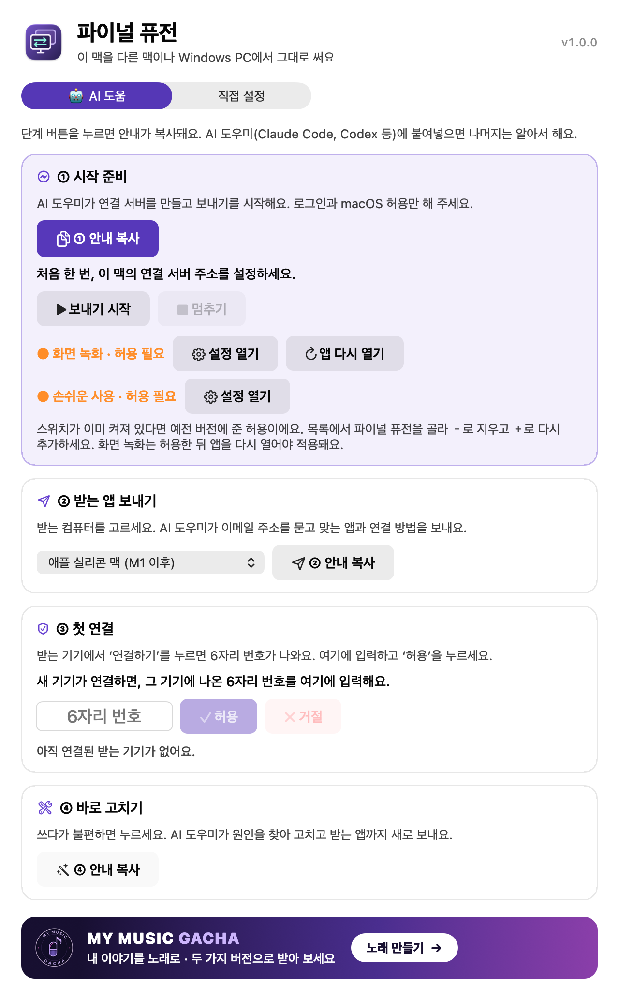

# 파이널 퓨전 · Final Fusion 1.0

**내가 쓰려고 만들었습니다.**

크롬 원격은 화질이 나빠서 눈이 아프고, 구형 맥북은 지원이 끝나 애플 화면 공유가 안 되고, 좋은 노트북은 사춘기 딸이 가져가서 내가 쓰려고 구형 노트북에 최적 해상도를 헤드리스 상태의 맥 미니나 맥 스튜디오에서 바로 보내 주는 일을 최우선으로 하며, 맥의 단축키와 트랙패드 제스처를 지원하도록 원격 프로그램을 만들었습니다.

하시는 일 모두 잘되시기를 기원합니다.

**[맥 설치 파일 받기 · 1.0.4](https://github.com/salmanhyu-wq/final-fusion-remote/releases/download/v1.0.4/Final-Fusion-1.0.4-macOS.dmg)** · macOS 14 이상

**모니터 없이 켜 둔 맥 미니·맥 스튜디오를, 구형 노트북에서 내 맥처럼 쓰세요.** 집에 있는 맥은 그대로 두고, 노트북에서 선명한 화면과 익숙한 단축키를 씁니다.

[Read in English](README.en.md) · [만들기와 시험](DEVELOPMENT.md) · [사용 조건](LICENSE)

- **원본 화질:** 직접 연결과 받는 맥의 화면 크기가 맞으면 원본 픽셀로 보여 줍니다. 조건이 맞지 않으면 높은 화질로 연결합니다.
- **맥 단축키:** 받는 맥에서 필요한 권한을 켜면 ⌘+Tab, ⌘+Space 같은 키를 보내는 맥에서 쓸 수 있습니다.
- **소리:** 보내는 맥의 소리를 받는 기기에서 듣습니다. 듣는 동안 보내는 맥의 스피커는 음소거되고, 연결이 끝나면 원래대로 돌아옵니다. 맥 받는 앱의 옵션에서 끌 수 있습니다. 보내는 앱과 받는 앱 모두 1.0.7 이상이 필요합니다.
- **AI 도움:** 앱의 ①~④ 안내를 쓰는 AI 도우미에 붙여넣으세요. 연결 서버 설정, 받는 앱 만들기, 문제 진단과 코드 수정까지 안내합니다. 직접 설정도 할 수 있습니다.

## 시작하기

1. 보내는 맥에서 내려받은 `.dmg`를 열고 파이널 퓨전을 **응용 프로그램** 폴더로 옮기세요. 이 설치 파일은 Apple 공증을 받지 않아 처음 열 때 경고가 표시될 수 있습니다. [Apple 안내](https://support.apple.com/ko-kr/102445)를 참고하세요.
2. 파이널 퓨전에서 **① 안내 복사**를 누르고 AI 도우미에 붙여넣습니다. 내 Cloudflare 계정에 연결 서버를 준비하고, 맥에서 화면 녹화와 손쉬운 사용을 허용합니다.
3. **② 받는 앱 보내기**에서 받는 기기를 고릅니다. 내 맥에 연결하는 설치 파일은 보내는 맥에서 만든 뒤 **사용할 기기에만** 전달하세요.
4. 노트북에서 **연결하기**를 누르고, 처음 뜨는 6자리 번호를 보내는 맥의 **③ 첫 연결**에 입력합니다. 맥 노트북에서 시스템 단축키를 쓰려면 **단축키 켜기**를 누릅니다.

받는 앱은 보내는 맥에서 각자 만듭니다. 소스에서 앱을 만들고 싶다면 [빌드 안내](DEVELOPMENT.md)를 참고하세요. 연결은 사용자가 직접 준비한 서버를 쓰며, 가능하면 기기끼리 바로 연결합니다.

연결 중에도 보내는 맥의 파이널 퓨전 창을 열어 설정을 바꿀 수 있습니다. 받는 쪽 연결만 끝내려면 맥 노트북에서 **Fn + Control + Option + Command + F12**를 누르세요. Windows는 전체 화면에서 **Esc**를 길게 누른 다음 **연결 끊기**를 누르세요. 보내는 앱의 **송신 중지**는 화면 보내기 자체를 끕니다. 다시 켜려면 다른 원격 앱이나 보내는 맥에 직접 연결할 방법이 필요합니다.

보내는 맥의 앱을 새 버전으로 바꾸면, 연결된 맥 받는 앱에 **DIY 업데이트**를 보냅니다. 받는 앱 1.0.2 이상은 받은 업데이트를 자동으로 설치합니다. 1.0.0 받는 앱에서 처음 업데이트할 때는 한 번 **설치**를 눌러야 합니다. Windows 받는 앱은 보내는 맥에서 새로 만들어 옮기세요.

원본 화질은 보내는 맥의 해상도와 새 화면 영상이 준비되면 시작합니다. 모니터가 없는 맥에서 가상 화면이 주 화면이 되면 그 화면을 그대로 보냅니다. 화면 보호기가 계속 켜져 있으면 현재 화면으로 먼저 연결하고, 보호기가 끝나면 원본 화질로 다시 연결합니다.

## 어디까지 확인했나요?

| 기기 | 대상과 확인 범위 |
| --- | --- |
| 보내는 맥 | macOS 14 이상 대상. 맥 스튜디오에서 빌드와 모의 연결을 확인했습니다. 모니터 없는 부팅과 재접속은 기기·설정에 따라 별도 확인이 필요합니다. |
| 인텔 맥북 받기 | 이전 버전에서 실제 맥북으로 2560×1600 원본 화면과 직접 연결을 확인했습니다. 1.0에서의 실기 결과와 구분합니다. |
| M1 이후 맥 받기 | 인텔·애플 실리콘 공용 앱을 빌드합니다. macOS 11 이상 대상이며, M1 이후 받는 기기 실기 시험은 아직입니다. |
| Windows 받기 | Windows 10 이상 64비트, Edge 또는 Chrome 대상. 빌드와 모의 브라우저 화면을 확인했습니다. Windows 실기, 전체 화면 시스템 키와 호환성은 확인 전입니다. |

Windows에서는 맥과의 클립보드 공유를 지원하지 않습니다. 고화질과 시스템 단축키 동작은 기기, 맥 권한, 연결 상태에 따라 달라집니다.

## 막혔을 때

**④ 바로 고치기**의 안내를 내 AI 도우미에게 붙여넣으세요. 설정으로 해결되지 않으면 공개 코드를 받아 고치고 다시 시험하는 방법까지 안내합니다.

공개 이슈에는 버전, 운영체제, 어떤 버튼을 누르면 문제가 나는지만 적어 주세요. 진단이 필요하면 [공유용 진단](DEVELOPMENT.md)을 사용하고, 연결 주소·6자리 번호·받는 앱·개인 화면은 올리지 마세요.

소스를 보고 개인적으로 고쳐 쓸 수 있습니다. 외부 재배포는 현재 허용하지 않습니다. [사용 조건](LICENSE)을 확인하세요.
